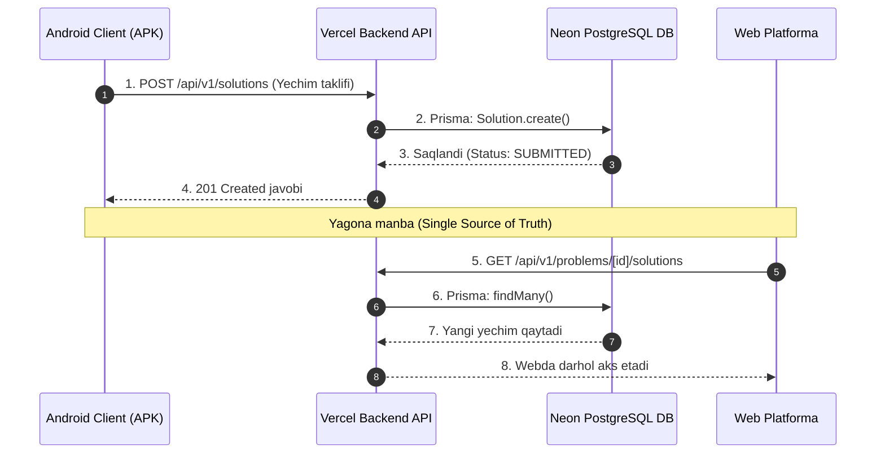

# YECHIMUZ ANDROID APK — MASTER ROADMAP v1.2.1
## Mobil Ilovani Ishlab Chiqish, Arxitektura, Sinxronizatsiya, Xavfsizlik va Google Play Reliz Muhandisligi Standarti

> **Loyiha Shiori:** *"Muammo qo‘ying. Yechim toping. Imkoniyat yarating."*  
> **Hujjat Turi:** Rasmiy Texnik va Amaliy Master Roadmap  
> **Versiya:** `v1.2.1 (Production Architecture, Strict Security & Play Store Release Engineering)`  
> **Sana:** 2026-yil 13-noyabr  
> **Bog‘langan Web Versiya:** `v1.1.0` (Git Commit: `0ecafce`)  
> **Rasmiy Production Web Domen:** `https://yechimuz-lovat.vercel.app`  
> **Rasmiy Production API Bazaviy Manzili:** `https://yechimuz-lovat.vercel.app/api/v1`  
> **Birlamchi Ma’lumotlar Bazasi:** Neon Tech PostgreSQL (Serverless Cloud DB)

---

## ⚠️ O‘ZGARTIRILMASLIGI KERAK BO‘LGAN QAT’IY QOIDALAR VA CHEGARALAR

Har qanday amaliy qadamdan oldin quyidagi 7 ta intizomiy tamoyil so‘zsiz amal qiladi:

1. **Foydalanuvchining aniq yozma ruxsatisiz birorta qator kod yozilmaydi.**
2. **Foydalanuvchining aniq yozma ruxsatisiz yangi GitHub repository ochilmaydi.**
3. **Mavjud Web platforma (`Husniddin05/yechimuz`) kodiga, dizayniga va funksiyalariga ruxsatsiz 1 bayt ham o‘zgartirish kiritilmaydi.**
4. **Vercel serveridagi mavjud Backend API ga ruxsatsiz o‘zgartirish kiritilmaydi.**
5. **Mavjud Production ma’lumotlar bazasi (Neon PostgreSQL) strukturasiga ruxsatsiz o‘zgartirish kiritilmaydi.**
6. **Hech qanday ruxsatsiz deploy yoki reliz qilinmaydi.**
7. **Tasdiqlanmagan texnologiyalar, farazlar yoki tekshirilmagan imkoniyatlar (masalan, Backendda mavjudligi tasdiqlanmagan FCM yoki tekshirilmagan Account Deletion API) "mavjud" deb hisoblanmaydi.**

---

## 1. LOYIHA HAQIDA UMUMIY MA’LUMOT VA BIZNES MANTIQ

YechimUZ — real muammosi bo‘lgan shaxslar va tashkilotlarni (Problem Owners) ushbu muammolarni amaliy hal qila oladigan mutaxassislar (Solvers: dasturchilar, muhandislar, startaplar, talabalar) bilan bog‘lovchi intellektual challenge platformasi.

### Asosiy Platforma Zanjiri:
$$\text{Muammo} \longrightarrow \text{AI Tahlil} \longrightarrow \text{Challenge/KPI} \longrightarrow \text{Yechimlar} \longrightarrow \text{Taqqoslash} \longrightarrow \text{Shortlist/Tanlash} \longrightarrow \text{Xavfsiz Chat} \longrightarrow \text{Pilot Sinov} \longrightarrow \text{Natija}$$

Platforma oddiy e’lonlar doskasi emas: foydalanuvchi ish qidirmaydi, balki o‘z qobiliyatiga mos muammoni topib, uni yechish orqali buyurtma, moliyaviy mukofot va nufuzli reytingga ega bo‘ladi.

---

## 2. TASDIQLANGAN TIZIM ARXITEKTURASI

Web va Android ilovalari to‘liq sinxron, lekin dasturchilar uchun versiyalarni mustaqil boshqarish imkonini beruvchi **Decoupled Client-Server** modelida ishlaydi:

```mermaid
flowchart TD
    subgraph WebRepo ["1-Repository (Mavjud: Husniddin05/yechimuz)"]
        WebCode["Web Platforma (Next.js 14 App Router)"]
        VercelDeploy["Vercel Cloud Server (Production Engine)"]
        WebCode -->|Avtomatik CI/CD| VercelDeploy
    end

    subgraph CentralDB ["Yagona Markaziy Baza (Single Source of Truth)"]
        NeonDB[("Neon Tech PostgreSQL (Production DB)")]
    end

    subgraph MobileRepo ["2-Repository (Yangi Mustaqil: yechimuz-android)"]
        MobileCode["Android Ilova Kod Bazasi (uz.yechim.app)"]
        AndroidDevice["Foydalanuvchi Qurilmasi (APK / AAB)"]
        MobileCode -->|Gradle Build| AndroidDevice
    end

    VercelDeploy <-->|Prisma ORM (Serverless Pooled)| NeonDB
    AndroidDevice <-->|Faqat HTTPS REST API (/api/v1)| VercelDeploy
```

### Arxitekturaviy Qoidalar:
- **Repository Izolyatsiyasi:** Web platforma o‘z repositorysida qoladi. Android ilova alohida mustaqil repositoryda (`Husniddin05/yechimuz-android`) ishlab chiqiladi.
- **Yagona Backend API:** Ikkala frontend faqat bitta markaziy API ga murojaat qiladi: `https://yechimuz-lovat.vercel.app/api/v1`.
- **Yagona Baza (Neon PostgreSQL):** Barcha muammolar, yechimlar, foydalanuvchilar va chat xabarlari faqat bitta markaziy bazada saqlanadi.
- **Taqiqlangan Bog‘lanish:** Android ilova hech qachon PostgreSQL bazasiga bevosita (TCP ulanish orqali) kirmaydi.
- **Alohida Baza Yo‘qligi:** APK uchun alohida ikkinchi backend yoki ikkinchi Production DB yaratilmaydi.
- **Daxlsizlik:** Web platforma kodi o‘zgartirilmaydi.

---

## 3. TEXNOLOGIYALAR VA VERSIYALAR (KOTLIN NATIVE VS CAPACITOR TAQQOSLASH)

Loyiha uchun ikki xil texnologik yo‘nalish mavjud. **Ushbu texnologiyalardan biri foydalanuvchi tomonidan yozma tasdiqlanmaguncha qat’iy tanlangan deb hisoblanmaydi.**

| Mezon | Variant A: Kotlin Native (Jetpack Compose) | Variant B: Capacitor (Web-Native Hybrid) |
| :--- | :--- | :--- |
| **Ishlash Tezligi** | **Yuqori (60-120 FPS).** Qurilma apparati va GPU bilan bevosita ishlash. Minimal kechikish. | **O‘rtacha-Yuqori.** Android System WebView orqali ishlaydi. DOM yuklamalari hisobiga xotira sarfi yuqoriroq. |
| **UI/UX Sifati** | **100% Native Material 3.** Tizim animatsiyalari, imo-ishoralar, haptik qayta aloqa, silliq skroll. | **Web Responsive UI.** Next.js sahifalari to‘g‘ridan-to‘g‘ri aks etadi. Mobil sensor sezgirligi cheklangan. |
| **Backend Integratsiyasi** | **Retrofit 2 + OkHttp 3.** JSON marshaling, CookieJar va Network Interceptor talab qiladi. | **Tabiiy integratsiya.** Web cookie va mavjud Next.js routing bilan to‘g‘ridan-to‘g‘ri ishlaydi. |
| **Push Notification** | **To‘liq nazorat.** Native `FirebaseMessagingService`, fonda va Foreground xizmatlarda cheklovsiz. | **Plagin orqali.** `@capacitor/push-notifications`. Ba’zi chuqur fon bildirishnomalarida plagin cheklovlari mavjud. |
| **Xavfsizlik** | **Maksimal.** Android Keystore, EncryptedSharedPreferences, ProGuard/R8 kod obfuskatsiyasi. | **Yaxshi.** WebView xavfsizligi, Content Security Policy (CSP) va SSL Pinning sozlanishi shart. |
| **Kelajakda Kengaytirish** | **Cheksiz.** Bluetooth, biometrika, murakkab offline sinxronizatsiya, maxsus fon vazifalari. | **Plaginlarga bog‘liq.** Tayyor plagin bo‘lmasa, Java/Kotlin native ko‘prik (bridge) yozish kerak. |
| **Texnik Xizmat** | **Alohida kod bazasi.** Kotlin tilida alohida mobil UI yoziladi va qo‘llab-quvvatlanadi. | **Yagona kod bazasi.** Web UI o‘zgarganda APK ham minimal harakat bilan yangilanadi. |
| **Google Play Mosligi** | **100% Mos.** Google Play tavsiyalariga to‘liq javob beradi. Kichik AAB hajmi. | **Mos, lekin ehtiyotkorlik zarur.** Agar ilova "faqat sayt oynasi" deb topilsa, Webview Policy tekshiruviga tushishi mumkin. |

---

## 4. ANDROID VA BACKEND INTEGRATSIYASI

Web va Android o‘rtasida ma’lumotlarning bir xil manbada bo‘lishi (Single Source of Truth) va real-time yangilanishi ikki xil talabdir:



### Cookie va Authorization Header Masalasi (Mavjud Backend Auditi):
Mavjud Web Backend (`src/app/api/v1/auth/login/route.ts`):
1. Kirish muvaffaqiyatli bo‘lganda JSON tanasida `{ success: true, token: "...", data: {...} }` qaytaradi.
2. Shuningdek, `Set-Cookie: yechimuz_token=...` sarlavhasini o‘rnatadi.
3. Biroq, `src/lib/auth.ts` ichidagi `getCurrentUserFromToken()` funksiyasi tokenni faqat `cookieStore.get("yechimuz_token")` orqali o‘qiydi.

**Texnik Integratsiya Qoidasi:**
- Android ilova tarmoq mijozi (OkHttp / Capacitor Http) har bir himoyalangan so‘rovda sarlavhaga `Cookie: yechimuz_token=<JWT_TOKEN>` qatorini uzatishi shart.
- Bu orqali Backend kodiga birorta ham o‘zgartirish kiritmasdan Android orqali to‘liq autentifikatsiyadan o‘tish kafolatlanadi.

---

## 5. AUTENTIFIKATSIYA VA XAVFSIZLIK TALABLARI

Android ilovasi Backend’dagi mavjud xavfsizlik va RBAC tekshiruvlarini aslo chetlab o‘tmaydi.

### 1. Tokenlarni Saqlash (Android Keystore):
- Tokenlar oddiy `SharedPreferences` faylida ochiq holda saqlanmaydi.
- `androidx.security.crypto.EncryptedSharedPreferences` yordamida, Android Keystore tomonidan himoyalangan AES-256 GCM kalitlari orqali shifrlanadi.

### 2. Token Muddati va Yangilanishi:
- Backenddagi token muddati — 7 kun (`maxAge: 604800` sek).
- Har qanday 401 Unauthorized xatosi kelib tushganda, ilova sessiyani darhol tozalaydi va xavfsiz holda Login ekraniga yo‘naltiradi.

### 3. Tarmoq Xavfsizligi:
- Barcha aloqalar faqat shifrlangan `HTTPS` orqali amalga oshiriladi.
- `AndroidManifest.xml` da `android:usesCleartextTraffic="false"` qat’iy o‘rnatiladi.

### 4. Maxfiy Ma’lumotlar Daxlsizligi:
- APK kodi ichiga hech qanday database paroli, JWT secret, server API kalitlari hardcode qilinmaydi.
- Debug va Release loglarida (`Logcat`) foydalanuvchi paroli, shaxsiy ma’lumotlari yoki tokenlar konsolga chiqarilishi qat’iyan taqiqlanadi.

### 5. Server Tomonidagi RBAC Himoyasi:
- Muammoni tahrirlash — faqat muammo egasiga ruxsat berilgan.
- Yechim baholash — faqat `EXPERT` yoki `ADMIN` roliga ega foydalanuvchiga ruxsat berilgan.
- Begona foydalanuvchilar chatga kirishga uringanda Backend 403 Forbidden qaytaradi va Android buni to‘g‘ri qayta ishlaydi.

---

## 6. UI/UX TALABLARI VA TASDIQLANGAN DIZAYN TIZIMI

Loyiha uchun tasdiqlangan ranglar, shriftlar va vizual standartlar saqlanadi:

```
┌────────────────────────────────────────────────────────────────────────┐
│                        TASDIQLANGAN RANGLAR                            │
├────────────────────────────────────────────────────────────────────────┤
│ 🔵 Deep Tech Blue:    #0D47A1 (Asosiy korporativ rang, AppBar, tugmalar)│
│ 🟢 Smart Teal:        #00897B (AI yordamchisi, ko'nikmalar, urg'u)     │
│ 🟡 Vibrant Gold:      #F59E0B (Mukofotlar, g'oliblar, reyting)         │
│ ⚪ Clean Neutral Light: #F8FAFC (Kunduzgi toza fon)                    │
│ ⚫ Modern Dark Surface: #0F172A (AMOLED qorong'u rejim foni)           │
└────────────────────────────────────────────────────────────────────────┘
```

### Asosiy Navigatsiya (Bottom Navigation Bar — 5 ta Bo‘lim):
1. **Bosh Sahifa (Home):** Shaxsiy salomlashuv, AI Moslik (Match) kartochkasi, top mukofotli muammolar.
2. **Bozor (Marketplace):** Barcha muammolar lentasi va 14 ta viloyat bo‘yicha filtr.
3. **Markaziy Tugma (FAB):** O‘rtadagi yaltiroq gradientli **`+ Muammo`** tugmasi.
4. **Yechimlarim (Solutions):** Yuborilgan takliflar holati va taqqoslash matritsasi.
5. **Profil (Profile):** Foydalanuvchi darajasi, yutuq nishonlari (Badges), daromad va reyting.

---

## 7. MARKETPLACE VA 14 TA VILOYAT KESIMIDAGI QIDIRUV

Foydalanuvchi taklifi asosida interaktiv xarita o‘rniga viloyatlar bo‘yicha toza va tezkor filtrlash o‘rnatiladi:
- O‘zbekistonning 14 ta ma’muriy hududi bo‘yicha saralash (Farg‘ona, Toshkent shahri, Toshkent viloyati, Samarqand, Andijon, Namangan, Buxoro, Xorazm, Qashqadaryo, Surxondaryo, Jizzax, Sirdaryo, Navoiy, Qoraqalpog‘iston Respublikasi).
- Kalit so‘z, kategoriya, byudjet va qiyinlik darajasi bo‘yicha kombinatsiyalangan qidiruv.
- Faqat internet mavjud bo‘lganda yuklanadi; tarmoq uzilsa darhol ogohlantirish beriladi.

---

## 8. AI PROBLEM ASSISTANT INTEGRATSIYASI

Muammoni erkin xalq tilida kiritish va uni professional Challenge formatiga aylantirish:
- Endpoint: `POST /api/v1/ai/generate-challenge`
- Kirish: Oddiy matn (masalan: *"Nasos tez-tez kuyyapti, tomchilatib sug'orishga avtomatika kerak"*).
- Chiqish: Challenge nomi, texnik vazifa tavsifi, kutilayotgan KPI metrikalari va kerakli ko‘nikmalar (Skills).
- **Human-in-the-Loop qoidasi:** AI tavsiyasini foydalanuvchi ekranda ko‘radi, xohlasa tahrirlaydi va faqat o‘zi tasdiqlagandagina e’lon qiladi (avtomatik publish taqiqlanadi).

---

## 9. YECHIMLAR VA TAQQOSLASH MATRITSASI (COMPARISON MATRIX)

Problem Owner kelgan bir nechta yechimlarni mobil formatda yonma-yon solishtirishi:
- Yechim topshirish: `POST /api/v1/solutions`
- Solishtirish parametrlari:
  * Taklif qilingan narx (UZS)
  * Bajarish muddati (kun)
  * Texnik yondashuv sifati
  * Ekspertlar qo‘ygan ball (Expert Overall Score 1.0 - 5.0)
- Bitta tugma orqali g‘olibni tanlash -> Yechim holati `SELECTED` ga o‘tadi.

---

## 10. SECURE CHAT INTEGRATSIYASI VA REAL-TIME TAQQOSLASH

### Mavjud Backend Chat Endpointlari:
- `GET /api/v1/chat/[solutionId]` — Xona ma’lumotlari va xabarlar tarixi.
- `POST /api/v1/chat/[solutionId]` — Yangi xabar jo‘natish (`{ content: string }`).
- `GET /api/v1/chat/my` — Foydalanuvchining barcha faol chatlari.

### Real-Time Sinxronizatsiya Texnologiyalari Tahlili:

| Mexanizm | Server Yuklamasi | Internet Sarfi | Kechikish | Vercel Serverless Mosligi |
| :--- | :--- | :--- | :--- | :--- |
| **A) 4 Soniyalik Polling (Webda Mavjud)** | O‘rtacha (har 4 sek so‘rov) | Kichik (faqat yangi xabarlar) | 0 - 4 soniya | **100% Mos.** Serverless funktsiyalar uchun eng barqaror va xavfsiz. |
| **B) WebSocket (Doimiy Aloqa)** | Yuqori (doimiy ochiq soket) | Minimal (faqat baytlar) | < 100 ms | **Cheklangan.** Vercel Serverless da qo‘shimcha tashqi server (Pusher/Socket.io cluster) talab qiladi. |
| **C) Server-Sent Events (SSE)** | O‘rtacha | Minimal | < 200 ms | **Qisman.** HTTP streaming uzoq vaqtli ulanishlarda Vercel timeout cheklovlariga ega. |

> **Yakuniy qaror:** Android ilovada Web platformadagi kabi **4 soniyalik aqlli polling** bilan boshlanadi (chat ekrani yopilganda yoki ilova minimizatsiya qilinganda polling darhol to‘xtatiladi, ortiqcha batareya va internet sarflanmaydi).  
> WebSocket yoki SSE ga o‘tish faqat alohida server ajratilganda va foydalanuvchi tasdiqlaganidan so‘ng amalga oshiriladi.

### Chat Xavfsizligi va Holatlari:
1. **Holat nazorati:** Chat faqat yechim statusi `SHORTLISTED`, `SELECTED`, `PILOT` yoki `COMPLETED` bo‘lganda ishlaydi.
2. **Begonalar kirishi taqiqlangan:** Muammoning egasi va yechim bergan Solver bo‘lmagan har qanday shaxsga 403 Forbidden qaytadi.
3. **Takroriy yuborishdan himoya (Client Debounce):** Xabar yuborish tugmasi bosilganda tugma darhol faolsizlantiriladi va tarmoq javobi kelguncha ikkinchi marta bosilishi bloklanadi.
4. **Yopiq Chat (`CLOSED`):** Agar xona yopilgan bo‘lsa, xabarlar faqat ko‘rish rejimida ochiladi, xabar yozish maydoni yopiladi.
5. **Bo‘sh va Yuklanish holatlari:** Chat bo‘sh bo‘lsa "Hali xabarlar yo‘q, birinchi xabarni yozing" vitrinasi, xatoda esa "Qayta urinish" tugmasi chiqadi.

---

## 11. PUSH NOTIFICATION (FCM) ARXITEKTURASI VA AUDIT TARTIBI

### ⚠️ Muhim Audit Cheklovi:
Backendda FCM xizmati mavjud deb oldindan taxmin qilinmaydi!  
**Tartib:**
1. Avval mavjud Backend kodi auditi o‘tkaziladi:
   - `DeviceToken` modeli bormi?
   - Token qabul qiluvchi API bormi?
   - Serverda Firebase Admin SDK o‘rnatilganmi?
2. Agar Backendda bu imkoniyatlar **mavjud bo‘lmasa**, Android uchun yangi API endpointlarni o‘zboshimchalik bilan yaratish taqiqlanadi.
3. Buning o‘rniga foydalanuvchiga **Alohida Texnik Taklif** taqdim etiladi va uning **yozma ruxsati olinadi**.
4. Foydalanuvchi ruxsat bersagina Backendga tegishli minimal kengaytma kiritiladi, aks holda ilova ichki bildirishnomalar bilan cheklanadi.

### Deep Linking Xaritasi:
- `TYPE: CHAT_MESSAGE` -> `uz.yechim.app://chat/{solutionId}`
- `TYPE: SOLUTION_STATUS` -> `uz.yechim.app://solution/{solutionId}`
- `TYPE: NEW_CHALLENGE` -> `uz.yechim.app://problem/{problemId}`

---

## 12. GOOGLE PLAY MARKETGA TAYYORLASH VA RELEASE MUHANDISLIGI

### 1. Reliz Parametrlari:
- **Package ID:** `uz.yechim.app`
- **Version Name:** `1.2.0`
- **Version Code:** `1`
- **Production Format:** `.aab` (Android App Bundle — Google Play talabi)
- **Ichki Test Formati:** `.apk`

### 2. Signing Key va Keystore Xavfsizligi (Muhim Farqlar):
- **Upload Key (`upload-keystore.jks`):** Dasturchi tomonidan kompyuterda yaratiladigan va faqat AAB faylini imzolash uchun ishlatiladigan kalit.
- **Google Play App Signing Key:** Google Play serverlarida xavfsiz saqlanadigan va foydalanuvchilar yuklab oladigan yakuniy APKlarni imzolaydigan asosiy kalit.
- **Xavfsizlik qoidasi:** `upload-keystore.jks`, uning parollari (`storePassword`, `keyPassword`) va `keyAlias` **HECH QACHON GitHub repositoryga commit qilinmaydi**. Bular `.gitignore` qilinadi va faqat lokal `keystore.properties` yoki CI/CD Environment Secrets da saqlanadi. Keystore faylining shifrlangan zaxira nusxasi (backup) xavfsiz oflayn xotirada saqlanadi.

### 3. Google Play `targetSdk` Versiyasini Aniqlash Tartibi:
- `targetSdk` versiyasi doimiy ravishda 34 deb qotirib qo‘yilmaydi.
- **Qoida:** Reliz chiqariladigan sanada Google Play rasmiy talabi ([developer.android.com/google-play/requirements/target-sdk](https://developer.android.com/google-play/requirements/target-sdk)) tekshiriladi:
  * 2024-yil 31-avgustdan: Yangi ilovalar va yangilanishlar uchun kamida `targetSdk 34` (Android 14).
  * 2025/2026 talablari e’lon qilinganda loyiha `targetSdk` versiyasi rasmiy talabga moslashtiriladi.
- Hozirgi barqaror parametrlar: `compileSdk = 34`, `minSdk = 26` (Android 8.0 Oreo va undan yuqori qurilmalar, bozorning 95%+ qamrovi).

### 4. Privacy Policy va Data Safety:
- **Privacy Policy:** Jonli, ochiq va doimiy ishlovchi URL sahifa (masalan: `https://yechimuz-lovat.vercel.app/privacy-policy`).
- **Data Safety Form:** Google Play konsolida qaysi ma’lumotlar yig‘ilishi (Ism, Email, Telefon raqam, Joylashuv) va ular shifrlangan holda (in transit HTTPS) uzatilishi aniq ko‘rsatiladi.

### 5. Account Deletion (Akkauntni O‘chirish) Talabi:
Google Play qoidalariga ko‘ra, agar ilovada ro‘yxatdan o‘tish bo‘lsa, akkauntni o‘chirish imkoniyati majburiydir:
1. **Ilova ichida:** Profil sozlamalarida "Akkauntni o‘chirish" tugmasi bo‘lishi shart.
2. **Tashqi Web sahifa:** Ilovani o‘chirib yuborgan foydalanuvchi uchun alohida tashqi veb havola mavjud bo‘lishi kerak.
- **Backend Audit Qoidasi:** Mavjud Backendda akkauntni o‘chirish API (`DELETE /api/v1/users/me`) mavjudligi tekshiriladi. Agar bunday API bo‘lmasa, u bor deb faraz qilinmaydi — foydalanuvchiga xabar berilib, kelishuv asosida texnik yechim ishlab chiqiladi.

---

## 13. PORTABLE ANDROID PROJECT — REALISTIK TALABLAR

> ❌ **Olib tashlangan noto‘g‘ri kafolat:** *"Boshqa istalgan kompyuterda bir martada to‘g‘ridan-to‘g‘ri RUN bo‘lishi kafolatlanadi."*  
> Har qanday dasturchi biladiki, yangi kompyuterda Android SDK, litsenziyalar yoki internet yo‘qligi build xatolariga sabab bo‘lishi mumkin.

### ✅ Realistik Standartlashtirish va Qayta Tiklash Talablari:
1. **Hujjatlashtirilgan Muhit:**
   - **JDK:** Java Development Kit 17 LTS (OpenJDK 17).
   - **Android SDK:** Platform SDK 34, Build-Tools 34.0.0.
   - **Gradle Wrapper:** `gradlew` va `gradlew.bat` skriptlari hamda `gradle-wrapper.properties` (Gradle 8.4+).
2. **Versiyalar Moslik Matritsasi (Compatibility Matrix):**
   - Android Gradle Plugin (AGP): `8.2.2` (yoki `8.3.+`)
   - Gradle Version: `8.4`
   - Kotlin Version: `1.9.22`
   - Jetpack Compose Compiler: `1.5.8`
   - Barcha kutubxonalar aniq fiksatsiyalangan versiyalarda kiritiladi (dinamik `+` taqiqlanadi).
3. **Ishga Tushirish Yo‘riqnomasi (`README.md`):**
   - 1-qadam: JDK 17 o‘rnatilganini tekshirish (`java -version`).
   - 2-qadam: Android Studio da loyihani "Open" qilish.
   - 3-qadam: Birinchi yuklanishda Gradle dependency va SDK litsenziyalarini yuklab olishi uchun internet mavjud bo‘lishi sharti.
   - 4-qadam: Emulator yoki real qurilmani tanlab `▶ Run` tugmasini bosish.
4. **Toza Muhitda Build Sinovi:**
   - Har qanday yangi kompyuterda terminal orqali:
     ```bash
     ./gradlew clean assembleDebug --no-daemon
     ```
     buyrug‘i orqali toza muhitda kompilyatsiya muvaffaqiyati tekshiriladi.

---

## 14. TESTLASH VA TEKSHIRISH STRATEGIYASI

| Test Turi | Sinov Vazifasi va Ssenariysi | Kutilayotgan Natija (Success Criteria) |
| :--- | :--- | :--- |
| **Unit Test** | Domain use-cases, formatlash, ma’lumotlar modeli parsingi | Barcha birlik testlar 100% yashil o‘tishi (`./gradlew test`). |
| **API Integration Test** | `POST /auth/login`, `GET /problems`, `GET /chat/[id]` | Server to‘g‘ri HTTP status (200, 201) va kutilgan JSON strukturasini qaytarishi. |
| **Authentication Test** | To‘g‘ri va xato parollar bilan kirish, logout jarayoni | Xato parolda xabar chiqadi, to‘g‘ri parolda token Keystore ga shifrlanadi. |
| **RBAC Security Test** | Begona foydalanuvchi sifatida boshqa yechim chatiga kirish | Server 403 Forbidden qaytaradi, ilova chatni ochmasdan xavfsiz xabar ko‘rsatadi. |
| **Chat Polling Test** | Bir vaqtning o‘zida Web va Androidda xabar yozish | Har ikki tomonda xabarlar 4 soniya ichida sinxron ko‘rinadi. |
| **No-Internet Test** | Qurilmada parvoz rejimini yoqish (Flight mode) | Ilova qotib qolmaydi, darhol "Internet bilan aloqa yo‘q" qizil dialog oynasi chiqadi. |
| **UI Responsiveness Test**| 5.0 dyuymli kichik telefon va 6.7 dyuymli katta ekranda ochish | Tugmalar, taqqoslash kartochkalari va matnlar ustma-ust tushmaydi. |
| **Versiyalar Mosligi** | Android 8.0 (API 26) dan Android 14 (API 34) gacha sinash | Barcha versiyalarda qulashlarsiz (crash-free) barqaror ishlashi. |
| **Release Signing Test** | `release.keystore` bilan imzolangan AAB ni tekshirish | `jarsigner -verify` muvaffaqiyatli o‘tishi, zipalign tasdiqlanishi. |

---

## 15. BOSQICHMA-BOSQICH AMALIY ISH REJASI (15 BOSQICH)

Har bir bosqich quyidagi 8 ta majburiy band asosida bajariladi:

```
┌────────────────────────────────────────────────────────────────────────┐
│               HAR BIR BOSQICHNING MAJBURIY STRUKTURASI                 │
├────────────────────────────────────────────────────────────────────────┤
│ 1. Bosqich Maqsadi                                                     │
│ 2. Bajariladigan Vazifalar                                             │
│ 3. Kerakli Texnologiyalar va Kutubxonalar                              │
│ 4. Kutilayotgan Natija                                                 │
│ 5. Qabul Qilish Mezonlari (Acceptance Criteria)                        │
│ 6. Test va Tekshirish Usuli                                            │
│ 7. Keyingi Bosqichga O'tish Sharti                                     │
│ 8. Foydalanuvchi Tasdig'i Talab Qilinadigan Holatlar                   │
└────────────────────────────────────────────────────────────────────────┘
```

---

### 1-BOSQICH: Mavjud Web Backend va API Auditi
1. **Maqsad:** Vercel serverdagi mavjud barcha API endpointlari, ularning sarlavhalari, cookielari va javob strukturalarini Android uchun to‘liq tekshirish.
2. **Vazifalar:** `/api/v1/auth/login`, `/problems`, `/solutions`, `/chat/[id]` endpointlarini Postman/curl orqali tekshirish; Cookie vs Header mexanizmini hujjatlashtirish.
3. **Texnologiyalar:** cURL, REST Client, JSON Schema validator.
4. **Kutilayotgan natija:** To‘liq API audit hujjati.
5. **Qabul qilish mezonlari:** Barcha endpointlarning kirish/chiqish parametrlari aniq bo‘lishi.
6. **Test usuli:** Jonli serverga test so‘rovlari yuborish.
7. **O‘tish sharti:** API audit hisoboti tayyor bo‘lishi.
8. **Foydalanuvchi tasdig‘i:** Backendda biror noaniqlik chiqsa, foydalanuvchiga ma’lum qilish.

---

### 2-BOSQICH: Android Texnologiyasini Tanlash va Tasdiqlash
1. **Maqsad:** Kotlin Native yoki Capacitor variantlaridan birini foydalanuvchi bilan birgalikda uzil-kesil tanlash.
2. **Vazifalar:** 8 ta mezonli tahlilni ko‘rib chiqish, loyiha maqsadlariga eng mos variantni muhokama qilish.
3. **Texnologiyalar:** Texnik spetsifikatsiya tahlili.
4. **Kutilayotgan natija:** Tanlangan yagona texnologik stek.
5. **Qabul qilish mezonlari:** Tanlovning loyiha budjeti, muddati va maqsadlariga to‘liq mos kelishi.
6. **Test usuli:** Arxitektura talablari bilan solishtirish.
7. **O‘tish sharti:** Foydalanuvchining aniq yozma roziligi.
8. **Foydalanuvchi tasdig‘i:** **MAJBURIY.** Foydalanuvchi yozma ruxsat bermaguncha amaliy kod yozilmaydi.

---

### 3-BOSQICH: Alohida Android Repository Tayyorlash
1. **Maqsad:** Web platforma kodiga tegmasdan yangi mustaqil GitHub repository yaratish.
2. **Vazifalar:** `yechimuz-android` papkasini ochish, `git init`, `.gitignore`, `README.md` ni joylash.
3. **Texnologiyalar:** Git, GitHub CLI / Web console.
4. **Kutilayotgan natija:** Toza, boshlang‘ich Git repository.
5. **Qabul qilish mezonlari:** Web repo bilan hech qanday bog‘liqlik bo‘lmasligi.
6. **Test usuli:** `git status` va `git remote -v` tekshiruvi.
7. **O‘tish sharti:** Yangi repository to‘g‘ri initsializatsiya qilinishi.
8. **Foydalanuvchi tasdig‘i:** Yangi repository ochish bo‘yicha foydalanuvchi roziligi.

---

### 4-BOSQICH: Loyiha Arxitekturasi va Muhitini Sozlash
1. **Maqsad:** Tanlangan texnologiya bo‘yicha loyiha karkasini (Clean Architecture) va Gradle muhitini qurish.
2. **Vazifalar:** Gradle Wrapper (8.4), SDK 34, JDK 17, `app/build.gradle.kts`, papkalar strukturasi (`core`, `data`, `domain`, `presentation`).
3. **Texnologiyalar:** Android Studio, Gradle, Kotlin/Java.
4. **Kutilayotgan natija:** Bo‘sh, lekin xatosiz yig‘iladigan (buildable) loyiha.
5. **Qabul qilish mezonlari:** `./gradlew assembleDebug` komandasi 0 ta xato bilan tugashi.
6. **Test usuli:** Terminalda loyihani toza kompilyatsiya qilish.
7. **O‘tish sharti:** Debug APK muvaffaqiyatli hosil bo‘lishi.
8. **Foydalanuvchi tasdig‘i:** Gradle va SDK sozlamalari tasdiqlanishi.

---

### 5-BOSQICH: Autentifikatsiya va API Integratsiyasi
1. **Maqsad:** Foydalanuvchini ro‘yxatdan o‘tkazish, login qilish va tokenni Keystore da xavfsiz saqlash.
2. **Vazifalar:** LoginScreen, RegisterScreen, Retrofit/OkHttp CookieJar, EncryptedSharedPreferences.
3. **Texnologiyalar:** Jetpack Compose, Retrofit 2, Androidx Security Crypto.
4. **Kutilayotgan natija:** Webdagi mavjud hisob bilan Androidda tizimga kirish.
5. **Qabul qilish mezonlari:** Tizimga muvaffaqiyatli kirish, 401 xatosida qayta loginga yo‘naltirish.
6. **Test usuli:** Real test akkaunti bilan tizimga kirib ko‘rish.
7. **O‘tish sharti:** Profil ma’lumotlari serverdan to‘g‘ri yuklanishi.
8. **Foydalanuvchi tasdig‘i:** Auth ssenariysi tekshirilib tasdiqlanishi.

---

### 6-BOSQICH: Asosiy UI/UX Ekranlari (Dizayn Tizimi)
1. **Maqsad:** Tasdiqlangan korporativ ranglar (Deep Tech Blue, Smart Teal, Gold) asosida vizual qobiqni yaratish.
2. **Vazifalar:** Bottom Navigation Bar (5 ta bo‘lim), markaziy FAB tugmasi, Bosh sahifa salomlashuv bloki va Dark/Light theme.
3. **Texnologiyalar:** Jetpack Compose Material 3, Navigation Compose.
4. **Kutilayotgan natija:** Zamonaviy, ko‘rkam va responsiv foydalanuvchi interfeysi.
5. **Qabul qilish mezonlari:** Ekranlar o‘rtasida silliq o‘tish, ranglar dizayn kodlariga 100% mosligi.
6. **Test usuli:** Turli o‘lchamdagi emulyatorlarda vizual tekshiruv.
7. **O‘tish sharti:** Bosh menyu to‘liq ishlashi.
8. **Foydalanuvchi tasdig‘i:** UI ekranlar ko‘rinishini foydalanuvchi ma’qullashi.

---

### 7-BOSQICH: Marketplace va 14 ta Viloyat Qidiruvi Moduli
1. **Maqsad:** Barcha e’lon qilingan muammolarni ko‘rish va viloyatlar bo‘yicha saralash.
2. **Vazifalar:** ProblemListScreen, qidiruv paneli, 14 ta viloyat bo‘yicha dropdown/chips filtri, xato va bo‘sh holat (Empty State) ko‘rinishlari.
3. **Texnologiyalar:** Compose LazyColumn, Flow, StateFlow.
4. **Kutilayotgan natija:** Viloyat tanlanganda faqat o‘sha viloyat muammolari chiqishi.
5. **Qabul qilish mezonlari:** Serverdagi ma’lumotlar bilan 100% bir xil ro‘yxat shakllanishi.
6. **Test usuli:** Har bir viloyat bo‘yicha filtrni bosib tekshirish.
7. **O‘tish sharti:** Qidiruv va filtrlash xatosiz ishlashi.
8. **Foydalanuvchi tasdig‘i:** Filtrlar qulayligi tasdiqlanishi.

---

### 8-BOSQICH: AI Problem Assistant Integratsiyasi
1. **Maqsad:** Oddiy matndagi muammoni AI orqali Challenge formatiga aylantirish.
2. **Vazifalar:** `POST /api/v1/ai/generate-challenge` integratsiyasi, yuklanish animatsiyasi, tahrirlash oynasi va e’lon qilish tugmasi.
3. **Texnologiyalar:** Coroutines, ViewModel, Compose TextField.
4. **Kutilayotgan natija:** Foydalanuvchi matn kiritganda professional Challenge va KPI shakllanishi.
5. **Qabul qilish mezonlari:** AI natijasini faqat inson tasdiqlaganidan keyin e’lon qilinishi.
6. **Test usuli:** Yangi muammoni AI orqali e’lon qilib, Web platformada ko‘rinishini tekshirish.
7. **O‘tish sharti:** E’lon qilingan muammo darhol Web bazasida aks etishi.
8. **Foydalanuvchi tasdig‘i:** AI assistentining ishlash natijasi tasdiqlanishi.

---

### 9-BOSQICH: Yechimlar va Taqqoslash Matritsasi
1. **Maqsad:** Yechim topshirish va bir nechta takliflarni yonma-yon solishtirish.
2. **Vazifalar:** SubmitSolutionScreen, ComparisonMatrixScreen, yechim tanlash (`Select`) tugmasi.
3. **Texnologiyalar:** HorizontalPager / Row skroll, Card komponentlari.
4. **Kutilayotgan natija:** Muammo egasi narx, vaqt va ekspert balli bo‘yicha eng yaxshi yechimni tanlay olishi.
5. **Qabul qilish mezonlari:** Yechim tanlanganda uning statusi `SELECTED` ga o‘zgarishi.
6. **Test usuli:** Webda va Androidda status o‘zgarishini tekshirish.
7. **O‘tish sharti:** Tanlangan yechim bo‘yicha Chat ochilish sharti faollashishi.
8. **Foydalanuvchi tasdig‘i:** Taqqoslash matritsasi qulayligi ma’qullanishi.

---

### 10-BOSQICH: Secure Chat Integratsiyasi
1. **Maqsad:** Muammo egasi va Yechimchi o‘rtasida xavfsiz ichki muloqotni o‘rnatish.
2. **Vazifalar:** ChatScreen, `GET/POST /api/v1/chat/[id]`, 4 soniyalik polling, debounce, xabarlar baloni (Bubble UI), o‘qilganlik nazorati.
3. **Texnologiyalar:** OkHttp, Coroutine Timer / Polling Worker, Compose LazyList.
4. **Kutilayotgan natija:** Web va Android o‘rtasida to‘liq sinxron xabar almashinuvi.
5. **Qabul qilish mezonlari:** Begona odam kirganda 403 xatosi chiqishi, yopiq xonada yozish bloklanishi.
6. **Test usuli:** Webdan yozilgan xabarning Androidda 4 soniyada chiqishini tekshirish.
7. **O‘tish sharti:** Ikkala tomondan yozilgan xabarlar to‘liq yetib borishi.
8. **Foydalanuvchi tasdig‘i:** Chat xavfsizligi va tezligi tasdiqlanishi.

---

### 11-BOSQICH: Push Notification Auditi va Integratsiyasi
1. **Maqsad:** Mobil bildirishnomalar tizimini tekshirish va xavfsiz yo‘lga qo‘yish.
2. **Vazifalar:** Backend auditi, FCM integratsiyasi, Deep Link marshrutlari.
3. **Texnologiyalar:** Firebase Cloud Messaging SDK, NotificationManager.
4. **Kutilayotgan natija:** Yangi xabar kelganda telefonga bildirishnoma chiqishi va bosilganda to‘g‘ri chat ochilishi.
5. **Qabul qilish mezonlari:** Bildirishnoma orqali to‘g‘ri ekranga o‘tish.
6. **Test usuli:** Test xabarnomasi yuborib ko‘rish.
7. **O‘tish sharti:** FCM auditi to‘liq yakunlanishi va foydalanuvchi roziligi.
8. **Foydalanuvchi tasdig‘i:** **MAJBURIY.** Backendga qo‘shimcha talab bo‘lsa, yozma ruxsat olinadi.

---

### 12-BOSQICH: Xavfsizlik va Keng Qamrovli Testlash
1. **Maqsad:** Tizim barqarorligi, internet uzilishi va xavfsizlik chegaralarini sinash.
2. **Vazifalar:** No-Internet dialogi testi, Memory Leak tekshiruvi, RBAC tekshiruvi, xatoliklar logi tozaligi.
3. **Texnologiyalar:** Android Profiler, LeakCanary, JUnit.
4. **Kutilayotgan natija:** 0 ta qulash (crash-free), xavfsiz ishlash.
5. **Qabul qilish mezonlari:** Internet uzilganda ilova qulamasdan ogohlantirish oynasi ochilishi.
6. **Test usuli:** Parvoz rejimi (Flight mode) va xato ma’lumotlar bilan stress-test.
7. **O‘tish sharti:** Barcha test keyslar muvaffaqiyatli o‘tishi.
8. **Foydalanuvchi tasdig‘i:** Xavfsizlik hisoboti tasdiqlanishi.

---

### 13-BOSQICH: APK va AAB Yig‘ish (Production Build)
1. **Maqsad:** Reliz uchun rasmiy fayllarni ishlab chiqarish.
2. **Vazifalar:** `upload-keystore.jks` ni yaratish (GitHubga kiritmasdan), ProGuard/R8 qoidalarini sozlash, `app-release.aab` va sinov uchun `app-release.apk` yig‘ish.
3. **Texnologiyalar:** Gradle R8, Android Keytool, Zipalign.
4. **Kutilayotgan natija:** Imzolangan, himoyalangan va hajmi optimallashtirilgan reliz to‘plami.
5. **Qabul qilish mezonlari:** AAB faylining Google Play spetsifikatsiyalariga to‘liq mos kelishi.
6. **Test usuli:** APK faylini real telefonga o‘rnatib ishga tushirish.
7. **O‘tish sharti:** Ilova telefonda muammosiz ochilishi.
8. **Foydalanuvchi tasdig‘i:** Test APK fayli foydalanuvchiga taqdim etilib, ma’qullanishi.

---

### 14-BOSQICH: GitHub va Google Play Relizga Tayyorlash
1. **Maqsad:** Loyihani rasmiy do‘kon talablariga to‘liq keltirish.
2. **Vazifalar:** Privacy Policy URL, Data Safety deklaratsiyasi, Account Deletion yechimi, App Icon, Screenshots.
3. **Texnologiyalar:** Google Play Console talablar ro‘yxati.
4. **Kutilayotgan natija:** Relizga 100% tayyor to‘plam.
5. **Qabul qilish mezonlari:** Google Play siyosatlariga ziddiyat yo‘qligi.
6. **Test usuli:** Play Console Pre-launch report tekshiruvlaridan o‘tkazish.
7. **O‘tish sharti:** Do‘kon talablari to‘liq bajarilishi.
8. **Foydalanuvchi tasdig‘i:** Google Play reliz parametrlari tasdiqlanishi.

---

### 15-BOSQICH: Yakuniy End-to-End Sinov va Topshirish
1. **Maqsad:** Butun ekotizimni real hayotiy ssenariyda sinab, loyihani topshirish.
2. **Vazifalar:** Web platforma va Android APK orqali to‘liq foydalanuvchi zanjirini bajarish: Ro‘yxatdan o‘tish -> Muammo qo‘yish -> AI tahlil -> Yechim berish -> Taqqoslash -> Shortlist -> Chatda gaplashish.
3. **Texnologiyalar:** Real qurilmalar (Android + Brauzer).
4. **Kutilayotgan natija:** 100% sinxron, barqaror va xatosiz ishlovchi platforma.
5. **Qabul qilish mezonlari:** Barcha jarayonlarning ikki tomonda birdek xatosiz aks etishi.
6. **Test usuli:** Real vaqt rejimida qadam-baqadam to‘liq test.
7. **O‘tish sharti:** Loyihaning to‘liq yakunlanishi.
8. **Foydalanuvchi tasdig‘i:** **YAKUNIY QABUL QILISH HUJJATI VA TASDIG‘I.**

---

## 16. ACCEPTANCE CRITERIA UMUMIY NAZORAT JADVALI

| Bosqich | Asosiy Mezon | Tasdiqlash Usuli |
| :---: | :--- | :--- |
| **B1** | Barcha API endpointlar dokumentatsiyalangan | cURL va JSON javoblar audit hujjati |
| **B2** | Texnologiya tanlovi tasdiqlangan | Foydalanuvchining yozma tasdig‘i |
| **B3** | Alohida mustaqil repository mavjud | `git remote -v` tekshiruvi |
| **B4** | Gradle toza kompilyatsiya bo‘ladi | `./gradlew assembleDebug` EXIT CODE 0 |
| **B5** | Auth token Keystore da shifrlangan | Androidx Crypto Keystore tekshiruvi |
| **B6** | 5 talik Bottom Navigation va FAB ishlaydi | Emulyatorda vizual tekshiruv |
| **B7** | 14 ta viloyat bo‘yicha filtr ishlaydi | Tanlangan viloyat muammolari chiqishi |
| **B8** | AI Challenge faqat inson roziligida chiqadi | Gemini javobini tahrirlash oynasi |
| **B9** | Yechimlar taqqoslanadi va tanlanadi | Status `SELECTED` ga o‘zgarishi |
| **B10**| Chat xabarlari 4 soniyada keladi | Web va Androidda jonli tekshirish |
| **B11**| Push notification auditdan o‘tgan | Backend FCM auditi hujjati |
| **B12**| Internet o‘chganda qulamasdan dialog chiqadi | Parvoz rejimi (Flight mode) testi |
| **B13**| Imzolangan AAB va APK yig‘iladi | `app-release.aab` fayli mavjudligi |
| **B14**| Account deletion va Data safety tayyor | Google Play siyosatiga moslik tekshiruvi |
| **B15**| Web va APK 100% sinxron ishlaydi | End-to-End to‘liq test protokoli |

---

## 17. TEXNIK RISKLAR VA CHEKLOVLAR (QARAMA-QARSHILIKLARNI OCHIQ QAYD ETISH)

1. **Vercel Serverless WebSocket Cheklovi:**  
   Vercel serverless funktsiyalari uzoq muddatli ochiq WebSocket aloqalarini qo‘llab-quvvatlamaydi (timeout cheklovlari bor). Shu sababli chat tizimida 4 soniyalik polling eng xavfsiz va barqaror yechimdir.
2. **Cookie va Native HTTP Mijozlar Farqi:**  
   Next.js server tomonida token cookiedan o‘qiladi. Agar Android Native Retrofit ishlatilsa, har bir so‘rovda `Cookie: yechimuz_token=...` sarlavhasini qo‘lda uzatuvchi `Interceptor` yozilishi shart.
3. **Google Play Account Deletion Talabi:**  
   Google Play akkauntni o‘chirishni majburiy qilgan, lekin Backendda hozircha `DELETE /api/v1/users/me` yo‘q bo‘lishi mumkin. Bu holat 1-bosqich auditida aniqlanib, foydalanuvchiga alohida yechim taklif etiladi.
4. **Google Play `targetSdk` Har Yillik Yangilanishi:**  
   Google har yili yangi Android versiyasini majburiy qiladi. Loyiha arxitekturasi `targetSdk` ni kelgusida oson oshirish imkoniyatini ta’minlashi kerak.

---

## 18. CHANGE LOG (v1.2.0 DAN v1.2.1 GA O‘ZGARISHLAR TARIXI)

1. **Noto‘g‘ri Kafolat Olib Tashlandi:** *"Har qanday kompyuterda bir martada to‘g‘ridan-to‘g‘ri RUN bo‘lishi kafolatlanadi"* degan realistik bo‘lmagan gap olib tashlandi; o‘rniga JDK 17, SDK 34, Gradle Wrapper, Dependency matritsasi va toza muhitda build sinovi talablari belgilandi.
2. **Google Play Release Chuqurlashtirildi:**
   - `upload-keystore.jks` va Google Play App Signing o‘rtasidagi farq aniq ajratildi.
   - Keystore va parollarni GitHub repositoryga mutlaqo yuklamaslik (.gitignore qoidasi) qat’iy kiritildi.
   - `targetSdk` versiyasini 34 deb qotirib qo‘ymasdan, reliz chiqariladigan paytda rasmiy hujjatlardan aniqlash tartibi belgilandi.
3. **Account Deletion Talabi Kiritildi:** Ilova ichidan va tashqi web sahifa orqali akkauntni o‘chirish siyosati belgilandi; backend imkoniyatlari tekshirilmasdan mavjud deb faraz qilinmaydigan bo‘ldi.
4. **FCM Push Notification Tartibi Qat’iylashtirildi:** Backendda FCM bor deb hisoblanmaydi; avval audit o‘tkaziladi, backend o‘zgarishi kerak bo‘lsa foydalanuvchining yozma ruxsati olinadi.
5. **Chat Polling vs WebSocket vs SSE Chuqur Taqqoslandi:** Vercel Serverless arxitekturasida 4 soniyalik polling nima uchun eng barqaror ekanligi texnik jihatdan asoslandi; debounce va CLOSED state kiritildi.
6. **15 Bosqichli Reja Kuchaytirildi:** Har bir bosqichga 8 ta majburiy band (Maqsad, Vazifalar, Texnologiyalar, Natija, Acceptance Criteria, Test usuli, O‘tish sharti, Foydalanuvchi tasdig‘i) kiritildi.
7. **Daxlsizlik va Xavfsizlik Mustahkamlandi:** Boshida va oxirida 7 ta daxlsizlik qoidasi ta’kidlandi. Ruxsatsiz kod yozmaslik va repo ochmaslik sharti qat’iy belgilandi.

---

## 🛑 YAKUNIY INTIZOMIY HOLAT

Ushbu **Master Roadmap v1.2.1** hujjati YechimUZ Android ilovasining barcha arxitektura, xavfsizlik, Google Play muhandisligi va integratsiya talablarini to‘liq va xatosiz qamrab olgan.

**Hozirgi holat:**
- Hech qanday kod yozilmagan.
- Hech qanday repository ochilmagan.
- Mavjud Web platformaga, Vercel serveriga yoki Neon PostgreSQL bazasiga biror o‘zgartirish kiritilmagan.
- Deploy amalga oshirilmagan.

Hujjat foydalanuvchiga taqdim etiladi va uning **aniq yozma roziligi hamda keyingi ko‘rsatmasi kutiladi**.
