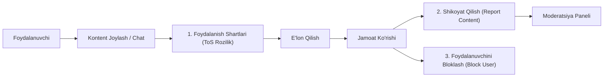

# YECHIMUZ ANDROID APK — MASTER ROADMAP v1.2.2
## Mobil Ilovani Ishlab Chiqish, Tizimli Arxitektura, Xavfsizlik, UGC Moderatsiya va Google Play Reliz Muhandisligi Standarti

> **Loyiha Shiori:** *"Muammo qo‘ying. Yechim toping. Imkoniyat yarating."*  
> **Hujjat Turi:** Rasmiy Texnik va Amaliy Master Roadmap  
> **Versiya:** `v1.2.2 (API 36 Alignment, Modern Keystore, UGC Moderation & Realistic Verification)`  
> **Sana:** 2026-yil 13-noyabr  
> **Bog‘langan Web Versiya:** `v1.1.0` (Git Commit: `0ecafce`)  
> **Rasmiy Production Web Domen:** `https://yechimuz-lovat.vercel.app`  
> **Rasmiy Production API Bazaviy Manzili:** `https://yechimuz-lovat.vercel.app/api/v1`  
> **Birlamchi Ma’lumotlar Bazasi:** Neon Tech PostgreSQL (Serverless Cloud DB)

---

## ⚠️ O‘ZGARTIRILMASLIGI KERAK BO‘LGAN QAT’IY QOIDALAR VA RUXSAT CHEGARALARI

Ushbu topshiriq **faqat reja va texnik spetsifikatsiyani yangilash** uchun mo‘ljallangan. Quyidagi intizomiy talablar qat’iy va so‘zsiz amal qiladi:

1. **Foydalanuvchining aniq yozma ruxsatisiz birorta qator Android kodi yozilmaydi yoki o‘zgartirilmaydi.**
2. **Backend kodi, Vercel sozlamalari va server konfiguratsiyasiga ruxsatsiz o‘zgartirish kiritilmaydi.**
3. **Mavjud Web platforma (`Husniddin05/yechimuz`) kodiga, dizayniga va funksiyalariga 1 bayt ham tegish taqiqlanadi.**
4. **Neon Tech PostgreSQL Production bazasi strukturasiga ruxsatsiz o‘zgartirish kiritilmaydi.**
5. **Git commit, push yoki yangi repository yaratish foydalanuvchi ruxsatisiz bajarilmaydi.**
6. **Vercel deployment yoki boshqa deploy operatsiyalari amalga oshirilmaydi.**
7. **Production muhitida ma’lumotlarni o‘zgartiruvchi (POST/PUT/DELETE) testlar bajarilmaydi; dastlabki API auditi FAQAT read-only bo‘ladi.**
8. **Yangi API endpointlarini o‘zboshimchalik bilan yaratish yoki mavjud bo‘lmagan imkoniyatlarni "bor" deb hisoblash qat’iyan man etiladi.**

---

## 1. LOYIHA HAQIDA UMUMIY MA’LUMOT VA BIZNES MANTIQ

YechimUZ — fuqarolar, fermerlar va tashkilotlar (Problem Owners) o‘z muammolarini erkin tilda joylashtiradigan, sun’iy intellekt (AI) uni professional Challenge’ga aylantiradigan, malakali mutaxassislar (Solvers) esa yechim taklif qilib buyurtma, daromad va reyting oladigan intellektual ekotizimdir.

### Asosiy Platforma Zanjiri:
$$\text{Muammo Joylash} \longrightarrow \text{AI Tahlil (Challenge/KPI)} \longrightarrow \text{Yechimlar Oqimi} \longrightarrow \text{Taqqoslash Matritsasi} \longrightarrow \text{Shortlist/Tanlash} \longrightarrow \text{1:1 Xavfsiz Chat} \longrightarrow \text{Pilot Sinov} \longrightarrow \text{Natija/Reyting}$$

Platforma oddiy e’lonlar sayti emas: unda barcha amallar tekshiriladigan mezonlar, ekspert baholari va xavfsiz shartnomaviy zanjir asosida kechadi.

---

## 2. TASDIQLANGAN TIZIM ARXITEKTURASI

Web va Android ilovalari bitta markaziy manbadan oziqlanuvchi, lekin mustaqil repozitoriylarda yuritiluvchi **Decoupled Client-Server** modelida ishlaydi:

```mermaid
flowchart TD
    subgraph WebRepo ["1-Repository (Mavjud: Husniddin05/yechimuz)"]
        WebCode["Web Platforma (Next.js 14 App Router)"]
        VercelDeploy["Vercel Cloud Server (Production Engine)"]
        WebCode -->|Avtomatik CI/CD| VercelDeploy
    end

    subgraph CentralDB ["Yagona Markaziy Baza (Single Source of Truth)"]
        NeonDB[("Neon Tech PostgreSQL (Production DB)")]
    end

    subgraph MobileRepo ["2-Repository (Yangi Mustaqil: yechimuz-android)"]
        MobileCode["Android Ilova Kod Bazasi (uz.yechim.app)"]
        AndroidDevice["Foydalanuvchi Qurilmasi (APK / AAB)"]
        MobileCode -->|Gradle Build| AndroidDevice
    end

    VercelDeploy <-->|Prisma ORM (Serverless Connection Pooling)| NeonDB
    AndroidDevice <-->|Faqat HTTPS REST API (/api/v1)| VercelDeploy
```

### Arxitekturaviy Asoslar:
- **Repository Izolyatsiyasi:** Web platforma va Android ilova mutlaqo alohida repozitoriylarda yashaydi. Bu versiya to‘qnashuvlarini istisno qiladi.
- **Yagona Backend API:** Ikkala frontend `https://yechimuz-lovat.vercel.app/api/v1` bazaviy manziliga murojaat qiladi.
- **Baza Daxlsizligi:** Android ilova Neon PostgreSQL bazasiga to‘g‘ridan-to‘g‘ri (TCP socket) ulanmaydi, barcha amallar API orqali amalga oshiriladi.
- **Ikkinchi Baza Yo‘qligi:** APK uchun alohida parallel backend yoki ikkinchi Production DB yaratilmaydi.

---

## 3. ANDROID TEXNOLOGIK TALABLARI VA VERSIYALAR MOSLIK MATRITSASI

v1.2.2 versiyasida Android ekotizimining eng so‘nggi barqaror va Google Play talablariga mos texnologik to‘plami belgilandi:

### Texnologik To‘plam Parametrlari:
- **`compileSdk`:** `36` (Android 15 / 16 Preview API mosligi bilan eng so‘nggi platforma imkoniyatlari).
- **`targetSdk`:** `36` (Kamida 36, reliz chiqariladigan vaqtda Google Play rasmiy talabi qayta tekshiriladi).
- **`minSdk`:** `26` (Android 8.0 Oreo — zamonaviy xavfsizlik va kriptografiya imkoniyatlarining quyi chegarasi; texnik audit davomida o‘zgartirish zarurati aniqlanmasa, o‘zgarmaydi).
- **JDK Versiyasi:** `Java 17 LTS` (Android Gradle Plugin va Compose uchun qat’iy talab).
- **Android Gradle Plugin (AGP):** `8.9.1` (API 36 bilan to‘liq mos).
- **Gradle Wrapper:** `8.11.1` (AGP 8.9.1 bilan rasmiy mosligi tasdiqlangan).

### Rasmiy Moslik Matritsasi (Compatibility Matrix):

| Komponent | Versiya | Izoh |
| :--- | :--- | :--- |
| **JDK** | 17 LTS (Eclipse Temurin / OpenJDK) | Majburiy kompilyatsiya muhiti |
| **Gradle** | 8.11.1 | Wrapper orqali loyihaga biriktiriladi |
| **Android Gradle Plugin (AGP)** | 8.9.1 | compileSdk 36 talablariga mos |
| **Kotlin** | 2.0.21 / 2.1.0 | Zamonaviy K2 kompilyatori bilan |
| **Compose Compiler Plugin** | Kotlin 2.0+ tarkibidagi rasmiy plagin | `org.jetbrains.kotlin.plugin.compose` |
| **Jetpack Compose BOM** | 2024.10.01 (yoki eng so‘nggi barqaror) | Material 3 va Foundation kutubxonalari |

> **Muhim:** Gradle Wrapper (`gradlew`, `gradlew.bat`, `gradle/wrapper/gradle-wrapper.properties`) loyiha repositorysiga to‘liq kiritiladi va mustaqil kompyuterda build qilish imkoniyati tekshiriladi.

---

## 4. TOKEN VA AUTENTIFIKATSIYA XAVFSIZLIGI

### 1. `EncryptedSharedPreferences` Deprecated Holati va Zamonaviy Yechim:
- Google rasmiy tavsiyasiga ko‘ra, `androidx.security:security-crypto` tarkibidagi `EncryptedSharedPreferences` texnik kamchiliklari sababli eskirgan (deprecated).
- **Rejalashtirilgan Yechim:** **Android Keystore Hardware-backed AES-256-GCM Shifrlash Wrapper** yoki **Jetpack DataStore Preferences + Custom Keystore Encryption Engine**.
- Tokenlar, foydalanuvchi ma’lumotlari va maxfiy kalitlar hech qachon oddiy (unencrypted) `SharedPreferences` da yoki Logcat loglarida ochiq matn (plain-text) holida saqlanmaydi.

### 2. Zaxira Nusxa (Auto Backup) Xavfsizligi:
- Qurilma Google Cloud zaxirasiga (`android:allowBackup="true"`) ma’lumot yuklaganda, shifrlash kalitlari va tokenlar oshkor bo‘lmasligi uchun `AndroidManifest.xml` da `android:dataExtractionRules` va `android:fullBackupContent` orqali kesh va Keystore fayllari zaxiradan istisno qilinadi (exclude).

### 3. Backend Autentifikatsiya Auditi va Cookie Mexanizmi:
- Real Backend kodi auditi shuni ko‘rsatadiki, `POST /api/v1/auth/login` token qaytarish bilan birga `Set-Cookie: yechimuz_token=...` o‘rnatadi. Biroq himoyalangan yo‘llar faqat cookiedan o‘qiydi.
- **Shart:** OkHttp mijozi uchun `PersistentCookieJar` integratsiyasi rejalashtiriladi. Cookie muddati (`maxAge: 7 kun`), domen, yo‘l (`path: /`) va `Secure` atributlari real so‘rovlarda sinovdan o‘tkaziladi.
- **Kafolat Cheklovi:** Cookie orqali autentifikatsiya ishlashi real qurilmada to‘liq sinovdan o‘tmaguncha "kafolatlangan" deb hisoblanmaydi.

### 4. 401 Xatoliklarini Boshqarish:
- Har qanday 401 xatosida sessiyani darhol ko‘r-ko‘rona o‘chirib yuborish noto‘g‘ri.
- **Mexanizm:** 401 xatosi kelganda faqat server javobi `TOKEN_EXPIRED` yoki `INVALID_TOKEN` deb qaytsagina sessiya tozalanadi va foydalanuvchi login ekraniga yo‘naltiriladi. Tarmoq uzilishi yoki ruxsat xatolarida sessiya saqlanib qoladi.
- **Cheklov:** Backendda mavjud bo‘lmagan `refresh-token` endpointi o‘zboshimchalik bilan qo‘shilmaydi.

---

## 5. API VA BACKEND AUDIT JADVALI (UNVERIFIED STATUSI BILAN)

Barcha endpointlar real kod auditi va test orqali tekshirilishi majburiy. Hozirgi holatda auditdan o‘tmagan endpointlar **UNVERIFIED** deb belgilanadi:

| Yo‘nalish | Endpoint | Metod | Auth Talabi | Android Bilan Moslik | Holati |
| :--- | :--- | :---: | :---: | :--- | :---: |
| **Auth** | `/api/v1/auth/register` | `POST` | Yo‘q | JSON body qabul qiladi | **VERIFIED (Code audit)** |
| **Auth** | `/api/v1/auth/login` | `POST` | Yo‘q | JSON + Set-Cookie qaytaradi | **VERIFIED (Code audit)** |
| **Auth** | `/api/v1/auth/me` | `GET` | Bor | Cookie talab qiladi | **VERIFIED (Code audit)** |
| **Auth** | `/api/v1/auth/logout` | `POST` | Bor | Cookieni tozalaydi | **VERIFIED (Code audit)** |
| **Profile** | `/api/v1/users/profile` | `GET` | Bor | Foydalanuvchi profili | **UNVERIFIED (Audit talab)** |
| **Problems** | `/api/v1/problems` | `GET` | Yo‘q | Ro‘yxat va filtrlar | **VERIFIED (Code audit)** |
| **Problems** | `/api/v1/problems` | `POST` | Bor | Muammo yaratish | **VERIFIED (Code audit)** |
| **Problems** | `/api/v1/problems/[id]` | `GET` | Yo‘q | Muammo tafsilotlari | **VERIFIED (Code audit)** |
| **AI** | `/api/v1/ai/generate-challenge` | `POST` | Bor | Gemini tahlil natijasi | **VERIFIED (Code audit)** |
| **Solutions** | `/api/v1/solutions` | `POST` | Bor | Yechim yuborish | **VERIFIED (Code audit)** |
| **Chat** | `/api/v1/chat/[solutionId]` | `GET` | Bor | Xabarlar tarixi | **VERIFIED (Code audit)** |
| **Chat** | `/api/v1/chat/[solutionId]` | `POST` | Bor | Xabar jo‘natish | **VERIFIED (Code audit)** |
| **Chat** | `/api/v1/chat/my` | `GET` | Bor | Barcha chatlar ro‘yxati | **VERIFIED (Code audit)** |
| **User Deletion**| `/api/v1/users/me` | `DELETE`| Bor | Akkauntni o‘chirish | **UNVERIFIED (Kafolatlanmagan)**|
| **Notifications**| `/api/v1/notifications` | `GET` | Bor | Bildirishnomalar | **UNVERIFIED (Audit talab)** |
| **FCM Token** | `/api/v1/users/fcm-token` | `POST` | Bor | Token saqlash | **UNVERIFIED (Mavjud emas)** |

> **Audit Sharti:** 1-bosqichda har bir UNVERIFIED endpoint bo‘yicha HTTP metodi, Request/Response formati va xatolik kodlari tekshirilib, hisobot taqdim etiladi.

---

## 6. SECURE CHAT VA REAL-TIME ALOQA TALABLARI

### 1. Polling Ishlash Shartlari:
- Web platformadagi kabi 4 soniyalik polling mexanizmi saqlanadi.
- **Qat’iy shart:** Polling FAQAT chat ekrani ochiq (`Lifecycle.State.RESUMED`) va ilova oldingi planda (Foreground) bo‘lganda ishlaydi.
- Ilova fon rejimiga o‘tganda, minimizatsiya qilinganda yoki boshqa ekranga o‘tilganda polling **darhol to‘xtatiladi** (`repeatOnLifecycle` orqali).
- **Backoff mexanizmi:** Tarmoq xatosi yoki server javobsizligida so‘rovlar oraliq vaqti bosqichma-bosqich oshiriladi (4s -> 8s -> 16s -> 30s) va ortiqcha server yuklamasining oldi olinadi.
- **Trafik tejamkorligi:** Har gal barcha xabarlar olinmaydi, faqat oxirgi qabul qilingan xabar vaqti (`lastMessageTimestamp`) bo‘yicha so‘rov yuborish imkoniyati audit qilinadi.

### 2. Real-Time Protokollari Taqqoslanishi:
- **WebSocket / Server-Sent Events (SSE):** Backend auditisiz ularning mavjudligi taxmin qilinmaydi. Vercel Serverless doimiy soketlarni to‘liq ushlab tura olmasligi sababli, dastlabki bosqichda faqat optimallashgan polling qo‘llaniladi.

### 3. Xatoliklarni Boshqarish va Holatlar:
- **Debounce:** Xabar yuborish tugmasi bosilganda tugma qulflanadi, takroriy bosishlar bloklanadi.
- **Chat CLOSED holati:** Xona yopilgan bo‘lsa, xabarlar faqat o‘qish rejimida ko‘rsatiladi, xabar yozish maydoni yashiriladi.
- **RBAC:** Faqat tegishli Problem Owner va Solver kira oladi (begonalarga 403 Forbidden).

---

## 7. USER-GENERATED CONTENT (UGC) VA MODERATSIYA STANDARTLARI

YechimUZ platformasida foydalanuvchilar o‘zlari muammolar, yechimlar va xabarlar joylashtirgani sababli, Google Play UGC xavfsizligi siyosati bo‘yicha quyidagi talablar kiritiladi:



### Majburiy UGC Himoya Mexanizmlari:
1. **Foydalanish Shartlari (Terms of Service):** Birinchi ro‘yxatdan o‘tishda va kontent joylashdan oldin haqoratomuz, noqonuniy yoki tajovuzkor materiallar taqiqlanishi haqida aniq ogohlantirish va rozilik olinishi.
2. **Shikoyat Qilish (Report Content / User):** Har bir muammo kartasida, yechim tafsilotlarida va chat xabarlarida "Shikoyat qilish" tugmasi bo‘lishi (Sabablari: Spam, haqorat, noqonuniy kontent, aldov).
3. **1:1 Chatda Bloklash (Block User):** Chatda nomaqbul xatti-harakat sodir etgan suhbatdoshni bitta tugma bilan bloklash imkoniyati (bloklangan odamdan qayta xabar kelmaydi).
4. **AI Natijalari Ustidan Shikoyat:** AI Assistant tomonidan generatsiya qilingan nomaqbul yoki noto‘g‘ri ma’lumotlar haqida xabar berish mexanizmi.
5. **Backend Bilan Bog‘liqlik:** Ushbu funksiyalar Backendda mavjud deb taxmin qilinmaydi. Agar Backendda `Report` va `Block` API lari bo‘lmasa, alohida texnik taklif kiritiladi va ruxsat asosida amalga oshiriladi.

---

## 8. ACCOUNT DELETION (HISOBNI O‘CHIRISH) TALABLARI

Google Play talablariga binoan, foydalanuvchi o‘z hisobini to‘liq o‘chirish huquqiga ega bo‘lishi shart:

### 1. Amalga Oshirish Yo‘llari:
- **Ilova ichida:** Profil sozlamalarida "Hisobni o‘chirish" (Delete Account) xavfsiz tugmasi.
- **Tashqi Veb Sahifa:** Ilovani o‘chirib yuborgan foydalanuvchilar uchun rasmiy veb-sahifa (masalan: `https://yechimuz-lovat.vercel.app/account-deletion`).

### 2. Ma’lumotlarni O‘chirish Siyosati:
- **Darhol o‘chiriladigan ma’lumotlar:** Foydalanuvchining login/paroli, telefon raqami, email manzili, biosi, profili va sessiyalari.
- **Qonuniy saqlanadigan ma’lumotlar:** Amalga oshirilgan moliyaviy tranzaksiyalar, shartnomalar yoki yakunlangan yuridik audit yozuvlari qonunchilik talabiga ko‘ra anonimlashtirilgan holda saqlanishi haqida foydalanuvchiga bildirishnoma beriladi.

### 3. Backend Holati:
- `DELETE /api/v1/users/me` endpointi mavjudligi kod auditi orqali tekshiriladi. Audit tasdiqlamaguncha u **UNVERIFIED** deb belgilanadi.

---

## 9. GOOGLE PLAY CHECKLIST VA SHAXSIY DEVELOPER AKKAUNT TALABI

Google Play do‘koniga muvaffaqiyatli reliz qilish uchun alohida nazorat ro‘yxati:

### 1. Do‘kon Majburiy Talablari:
- [ ] **Privacy Policy:** Jonli, ochiq ishlovchi veb-havola.
- [ ] **Data Safety Form:** Yig‘iladigan ma’lumotlar (Ism, Email, Telefon) to‘liq deklaratsiyalanishi.
- [ ] **App Content & Target Audience:** Yosh chegarasi (18+) va reklama yo‘qligi (`No Ads`) e’lon qilinishi.
- [ ] **Content Rating:** IARC so‘rovnomasidan o‘tish.
- [ ] **App Access (Tekshiruvchilar uchun kirish):** Google Play testerlari uchun maxsus ishchi demo login va parol taqdim etilishi.
- [ ] **Store Listing:** Rasmiy skrinshotlar (telefon va planshet), qisqa va to‘liq tavsif, 512x512 yuqori sifatli ikonka, 1024x500 Feature Graphic banner.
- [ ] **Maxfiy Ruxsatlar Auditi:** Faqat zarur ruxsatlar (`INTERNET`, `ACCESS_NETWORK_STATE`, ixtiyoriy `POST_NOTIFICATIONS`) olinishi; xavfli ruxsatlar kiritilmasligi.

### 2. 2023-yil 13-noyabrdan Keyin Yaratilgan Shaxsiy Developer Akkauntlar Sharti:
> ⚠️ **Muhim Qoida:** Agar Google Play Console hisobi **shaxsiy (Personal)** bo‘lsa va **2023-yil 13-noyabrdan keyin** ro‘yxatdan o‘tgan bo‘lsa, ilovani Production relizga chiqarishdan oldin **kamida 12 nafar testerning 14 kun davomida uzluksiz yopiq testda (Closed Testing)** qatnashishi shart.  
> Agar hisob tashkiliy (Organization) bo‘lsa, ushbu 14 kunlik talab qo‘llanilmaydi. Akkaunt turi relizdan oldin aniqlanadi.

### 3. Keystore Xavfsizligi:
- `upload-keystore.jks` faqat lokal mashinada yoki CI/CD secretlarida saqlanadi.
- `.gitignore` da `*.jks`, `*.keystore`, `keystore.properties` qat’iy bloklanadi.

---

## 10. REAL O‘LCHANADIGAN METRIKALAR (MUTLAQ DA’VOLAR O‘RNIGA)

v1.2.2 da isbotlanmagan, mutlaq iboralar o‘lchanadigan texnik metrikalarga almashtirildi:

| Eski Mutlaq Da’vo | Yangi O‘lchanadigan Haqiqiy Standart |
| :--- | :--- |
| *"100% Google Play mos"* | Google Play pre-launch reportda 0 ta qizil xatolik va siyosatlarga to‘liq javob berishi. |
| *"100% sinxronizatsiya"* | Yagona Neon PostgreSQL bazasi orqali barcha ma’lumotlarning to‘g‘ri saqlanishi va 4s ichida chat yangilanishi. |
| *"0 ta crash"* | Firebase Crashlytics monitoringida **Crash-Free Users ko‘rsatkichi kamida 99.5%** bo‘lishi. |
| *"95% qurilmalarni qamrab olish"* | `minSdk 26` (Android 8.0+) orqali bozorning rasmiy statistikada 95%+ qurilmalarida o‘rnatilishi. |
| *"Maksimal xavfsizlik"* | Android Keystore shifrlashi, HTTPS majburiyligi, RBAC tekshiruvi va xavfsiz cookie boshqaruvi. |
| *"Cheksiz background services"* | Android 14+ background cheklovlariga muvofiq, faqat standart Lifecycle-aware vazifalar ishlatilishi. |

---

## 11. PORTABLE ANDROID PROJECT — REALISTIK TALABLAR

- **Muhit talablari:** JDK 17 LTS, Android SDK Platform 36, Build-Tools 36.0.0.
- **Mustaqil Build Sinovi:** Loyihani yangi toza muhitda yoki boshqa kompyuterda terminal orqali:
  ```bash
  ./gradlew clean assembleDebug --no-daemon
  ```
  buyrug‘i bilan muvaffaqiyatli build qilish imkoniyati tekshiriladi.
- **Yo‘riqnoma:** Yangi muhitda birinchi marta Gradle dependency va litsenziyalarni yuklab olish uchun internet talab etilishi `README.md` da aniq qayd etiladi.

---

## 12. TESTLASH VA TEKSHIRISH STRATEGIYASI

Quyidagi 13 turdagi testlar ishlab chiqish va qabul qilishning asosi hisoblanadi:

1. **Unit Test:** Domen modellari, ma’lumotlar konvertatsiyasi va biznes mantiq.
2. **API Integration Test (Read-Only):** Vercel API endpointlariga read-only so‘rovlar.
3. **Authentication Test:** To‘g‘ri/noto‘g‘ri ma’lumotlar, cookie saqlanishi va Keystore tekshiruvi.
4. **RBAC Test:** Begona foydalanuvchining boshqa yechim chatiga kira olmasligi (403 xatosi).
5. **Chat Polling Test:** Faol ekranda 4s yangilanish, fon rejimida to‘xtashi.
6. **No-Internet Test:** Tarmoq o‘chganda ilova qulamasdan "Internet bilan aloqa yo‘q" dialogi chiqishi.
7. **Backoff Reconnect Test:** Internet qayta ulanganda chat va ma’lumotlarning avtomatik tiklanishi.
8. **UGC Moderation Test:** Kontent ustidan shikoyat yuborish va foydalanuvchini bloklash oqimi.
9. **UI Responsiveness Test:** Kichik (5.0") va katta (6.7") ekranlarda dizayn buzilmasligi.
10. **Versiyalar Mosligi Testi:** Android 8.0 (API 26) dan Android 15/16 (API 36) gacha barqarorlik.
11. **Release Signing Test:** Upload keystore bilan AAB imzolanishi va `jarsigner` tasdig‘i.
12. **APK Install & Launch Test:** Haqiqiy jismoniy telefonga o‘rnatib, muammosiz ochilishi.
13. **Account Deletion Test:** Akkauntni o‘chirish oqimining xavfsiz va xatosiz ishlashi.

---

## 13. BOSQICHMA-BOSQICH AMALIY ISH REJASI (15 BOSQICH)

Har bir bosqich qat’iy 7 ta majburiy qism asosida bajariladi:

```
┌────────────────────────────────────────────────────────────────────────┐
│               HAR BIR BOSQICHNING MAJBURIY STRUKTURASI                 │
├────────────────────────────────────────────────────────────────────────┤
│ 1. Maqsad                                                              │
│ 2. Bajariladigan Vazifalar                                             │
│ 3. Texnologiyalar va Kutubxonalar                                      │
│ 4. Kutiladigan Natija                                                  │
│ 5. Qabul Qilish Mezonlari (Acceptance Criteria)                        │
│ 6. Bog'liqliklar (Dependencies)                                        │
│ 7. Xavflar va Cheklovlar                                               │
└────────────────────────────────────────────────────────────────────────┘
```

---

### 1-BOSQICH: Mavjud Web Backend va API Auditi (Read-Only)
1. **Maqsad:** Verceldagi barcha mavjud API endpointlarini read-only tarzda to‘liq audit qilish va UNVERIFIED ro‘yxatiga aniqlik kiritish.
2. **Vazifalar:** `/auth/*`, `/problems/*`, `/solutions/*`, `/chat/*`, `/users/*` endpointlarining metodlari, cookie talablari va JSON formatini tekshirish.
3. **Texnologiyalar:** cURL, Postman/Thunder Client, JSON Schema.
4. **Kutiladigan natija:** To‘liq API Audit Hujjati (qaysi endpointlar bor, qaysilari yo‘q).
5. **Qabul mezonlari:** Barcha so‘rovlar va javoblar spetsifikatsiyasining aniq tasdiqlanishi.
6. **Bog‘liqliklar:** Jonli Vercel serverining ishlab turishi.
7. **Xavflar:** Ba’zi endpointlar (masalan, akkauntni o‘chirish yoki FCM) mavjud bo‘lmasligi mumkin.

---

### 2-BOSQICH: Android Texnologiyasini Tanlash va Tasdiqlash
1. **Maqsad:** Kotlin Native (Jetpack Compose) va Capacitor variantlari bo‘yicha foydalanuvchining yakuniy yozma qarorini olish.
2. **Vazifalar:** 8 ta mezonli taqqoslash hisobotini tahlil qilish, loyiha maqsadiga mos variantni tasdiqlash.
3. **Texnologiyalar:** Texnik spetsifikatsiya.
4. **Kutiladigan natija:** Tanlangan yagona texnologik yo‘nalish.
5. **Qabul mezonlari:** Foydalanuvchining aniq yozma roziligi.
6. **Bog‘liqliklar:** 1-bosqich API auditi xulosasi.
7. **Xavflar:** Tanlov kechiksa, keyingi amaliy qadamlar to‘xtab turadi.

---

### 3-BOSQICH: Alohida Android Repository Tayyorlash
1. **Maqsad:** Web platforma kodiga mutlaqo aralashmaydigan mustaqil GitHub repository tashkil etish.
2. **Vazifalar:** `yechimuz-android` papkasini ochish, `git init`, `.gitignore`, `README.md` ni sozlash.
3. **Texnologiyalar:** Git, GitHub.
4. **Kutiladigan natija:** Toza, boshlang‘ich Android repository.
5. **Qabul mezonlari:** Web repo bilan birorta fayl aralashmasligi, `git status` tozaligi.
6. **Bog‘liqliklar:** 2-bosqich tasdig‘i va foydalanuvchi ruxsati.
7. **Xavflar:** Ruxsatsiz repo ochish taqiqlangan.

---

### 4-BOSQICH: Loyiha Arxitekturasi va Muhitini Sozlash (API 36, AGP 8.9.1, Gradle 8.11.1)
1. **Maqsad:** Loyihaning poydevorini (Clean Architecture, Gradle Wrapper, moslik matritsasi) qurish.
2. **Vazifalar:** `compileSdk 36`, `targetSdk 36`, `minSdk 26`, AGP `8.9.1`, Gradle `8.11.1`, Kotlin `2.0+` Compose plaginini kiritish, papkalar strukturasini ochish.
3. **Texnologiyalar:** Gradle, Android SDK 36, JDK 17 LTS.
4. **Kutiladigan natija:** Bo‘sh, lekin toza kompilyatsiya bo‘ladigan Android loyihasi.
5. **Qabul mezonlari:** `./gradlew clean assembleDebug` 0 xato bilan tugashi.
6. **Bog‘liqliklar:** 3-bosqich repo tayyorligi.
7. **Xavflar:** Yangi SDK va AGP versiyalarida litsenziya yuklanish kechikishlari.

---

### 5-BOSQICH: Autentifikatsiya, Zamonaviy Keystore va Cookie Boshqaruvi
1. **Maqsad:** Foydalanuvchini tizimga kiritish, `yechimuz_token` cookielarini boshqarish va sessiyani Keystore da xavfsiz saqlash.
2. **Vazifalar:** LoginScreen, RegisterScreen, OkHttp `PersistentCookieJar`, Keystore AES-256 shifrlash wrapperi, 401 xatosida selektiv tozalash.
3. **Texnologiyalar:** Jetpack Compose, OkHttp 3, Android Keystore.
4. **Kutiladigan natija:** Webda ro‘yxatdan o‘tgan profil bilan Androidda muvaffaqiyatli kirish.
5. **Qabul mezonlari:** Kirish muvaffaqiyati, cookielar xavfsiz yuborilishi, qayta ochganda sessiya saqlanishi.
6. **Bog‘liqliklar:** 1-bosqich auth auditi.
7. **Xavflar:** Serverda cookielarning muddati yoki Secure atributi mos kelmasligi ehtimoli.

---

### 6-BOSQICH: Asosiy UI/UX Ekranlari va Dizayn Tizimi
1. **Maqsad:** Tasdiqlangan ranglar (Deep Tech Blue, Smart Teal, Gold) asosida vizual navigatsiyani qurish.
2. **Vazifalar:** Bottom Navigation Bar (5 bo‘lim), markaziy FAB tugmasi, Bosh sahifa salomlashuvi, Dark/Light rejim.
3. **Texnologiyalar:** Compose Material 3, Navigation Compose.
4. **Kutiladigan natija:** Chiroyli, zamonaviy va qulay foydalanuvchi interfeysi.
5. **Qabul mezonlari:** Ekranlararo o‘tishlar silliq ishlashi, rang kodlariga to‘liq muvofiqlik.
6. **Bog‘liqliklar:** 5-bosqich auth oqimi.
7. **Xavflar:** Kichik ekranli qurilmalarda elementlar siqilishi (responsive tekshiruv shart).

---

### 7-BOSQICH: Marketplace va 14 ta Viloyat Kesimidagi Qidiruv
1. **Maqsad:** Muammolarni ko‘rish va O‘zbekiston viloyatlari bo‘yicha saralash.
2. **Vazifalar:** ProblemListScreen, qidiruv paneli, 14 ta viloyat dropdown/chips filtri, Empty State va Error State.
3. **Texnologiyalar:** Compose LazyColumn, Kotlin Flow, StateFlow.
4. **Kutiladigan natija:** Viloyat tanlanganda faqat o‘sha viloyat muammolarining chiqishi.
5. **Qabul mezonlari:** Serverdagi ma’lumotlar bilan 100% bir xil ro‘yxat shakllanishi.
6. **Bog‘liqliklar:** 6-bosqich UI tizimi va Backend `/problems` API.
7. **Xavflar:** Katta hajmdagi ma’lumotlarda paginatsiya audit talab qilishi.

---

### 8-BOSQICH: AI Problem Assistant Integratsiyasi
1. **Maqsad:** Oddiy xalq tilidagi matnni AI orqali Challenge va KPI ga aylantirish.
2. **Vazifalar:** `POST /api/v1/ai/generate-challenge` integratsiyasi, yuklanish animatsiyasi, inson tasdig‘i va tahrirlash oynasi.
3. **Texnologiyalar:** Coroutines, ViewModel, Compose TextField.
4. **Kutiladigan natija:** Foydalanuvchi matn yozganda professional Challenge shakllanishi.
5. **Qabul mezonlari:** AI natijasi faqat inson roziligi bilan e’lon qilinishi (Human-in-the-Loop).
6. **Bog‘liqliklar:** Gemini API va Backend AI servisi.
7. **Xavflar:** Gemini serverless chaqiruvlarida vaqt kechikishi (timeout handling talab qilinadi).

---

### 9-BOSQICH: Yechimlar va Taqqoslash Matritsasi (Comparison Matrix)
1. **Maqsad:** Solver yechim topshirishi va Problem Owner yechimlarni yonma-yon solishtirishi.
2. **Vazifalar:** SubmitSolutionScreen, ComparisonMatrixScreen, yechim tanlash (`Select`) tugmasi.
3. **Texnologiyalar:** Compose Card, Horizontal skroll komponentlari.
4. **Kutiladigan natija:** Yechimlar narx, muddat va ekspert balli bo‘yicha taqqoslanishi.
5. **Qabul mezonlari:** Yechim tanlanganda statusi `SELECTED` ga o‘zgarishi.
6. **Bog‘liqliklar:** Backend `/solutions` API.
7. **Xavflar:** Bir nechta yechimlar mavjud bo‘lmaganda matritsa bo‘sh ko‘rinishi.

---

### 10-BOSQICH: Secure Chat Integratsiyasi (Lifecycle-Aware Polling)
1. **Maqsad:** Owner va Solver o‘rtasida xavfsiz 1:1 chat aloqasini o‘rnatish.
2. **Vazifalar:** ChatScreen, `GET/POST /api/v1/chat/[id]`, 4s polling, `repeatOnLifecycle(RESUMED)`, backoff mexanizmi, debounce, CLOSED holat.
3. **Texnologiyalar:** Lifecycle Kotlin Coroutines, OkHttp.
4. **Kutiladigan natija:** Web va Android o‘rtasida to‘liq sinxron xabar almashinuvi.
5. **Qabul mezonlari:** Begona shaxsga 403 Forbidden chiqishi, fon rejimida polling to‘xtashi.
6. **Bog‘liqliklar:** 9-bosqichda yechimning `SELECTED`/`SHORTLISTED` bo‘lishi.
7. **Xavflar:** Tarmoq uzilganda xabarlarning qolib ketishi (retry mexanizmi shart).

---

### 11-BOSQICH: Push Notification (FCM) Auditi va Integratsiyasi
1. **Maqsad:** Bildirishnomalar arxitekturasini tekshirish va xavfsiz integratsiya qilish.
2. **Vazifalar:** Backend auditi (DeviceToken bormi?), agar bo‘lsa FCM SDK integratsiyasi, Deep Link yo‘naltirishlari.
3. **Texnologiyalar:** Firebase Messaging SDK, Android NotificationManager.
4. **Kutiladigan natija:** Yangi chat xabari yoki status o‘zgarganda bildirishnoma kelishi.
5. **Qabul mezonlari:** Bildirishnoma bosilganda aynan o‘sha chat yoki yechim ekrani ochilishi.
6. **Bog‘liqliklar:** Backendda token saqlash API mavjudligi va foydalanuvchi yozma ruxsati.
7. **Xavflar:** Backendda FCM yo‘q bo‘lsa, ushbu bosqich faqat ichki bildirishnomalar bilan cheklanadi.

---

### 12-BOSQICH: UGC Moderatsiya, Xavfsizlik va Keng Qamrovli Testlash
1. **Maqsad:** Google Play UGC talablarini bajarish, internet uzilishi va xavfsizlikni sinash.
2. **Vazifalar:** Kontent ustidan shikoyat qilish (Report), chatda foydalanuvchini bloklash (Block), No-Internet dialogi testi, Memory Profiling.
3. **Texnologiyalar:** Android Profiler, JUnit, Compose UI Test.
4. **Kutiladigan natija:** Crash-Free 99.5%+, UGC xavfsizlik oqimlarining to‘liq ishlashi.
5. **Qabul mezonlari:** Internet uzilganda qulamasdan ogohlantirish chiqishi, bloklangan foydalanuvchi xabari ko‘rinmasligi.
6. **Bog‘liqliklar:** 5-11 bosqichlar integratsiyasi.
7. **Xavflar:** Backendda moderatsiya API bo‘lmasa, alohida texnik yechim talab etiladi.

---

### 13-BOSQICH: APK va AAB Yig‘ish (Production Build Muhandisligi)
1. **Maqsad:** Do‘kon va sinov uchun rasmiy imzolangan fayllarni yig‘ish.
2. **Vazifalar:** `upload-keystore.jks` ni yaratish (Gitga kiritmasdan), ProGuard/R8 qoidalarini tekshirish, `app-release.aab` va sinov uchun `app-release.apk` chiqarish.
3. **Texnologiyalar:** R8 Code Shrinker, Android Keytool, Zipalign.
4. **Kutiladigan natija:** Hajmi optimallashgan, himoyalangan AAB va APK fayllari.
5. **Qabul mezonlari:** `jarsigner -verify` muvaffaqiyati, APK ning real telefonda ochilishi.
6. **Bog‘liqliklar:** Barcha ekranlar va testlar yakunlanishi.
7. **Xavflar:** R8 obfuskatsiyasida model klasslarining yo‘qolib qolishi (ProGuard qoidalari shart).

---

### 14-BOSQICH: Google Play Checklist, Account Deletion va Reliz Tayyorgarligi
1. **Maqsad:** Google Play do‘koni barcha siyosiy talablarini 100% bajarish.
2. **Vazifalar:** Privacy Policy havolasi, Data Safety deklaratsiyasi, Account Deletion (ilova ichida + tashqi veb havola), 12 tester/14 kun testi talabini tekshirish, Store Listing.
3. **Texnologiyalar:** Google Play Console, Web sahifalar.
4. **Kutiladigan natija:** Play Console tekshiruviga to‘liq tayyor anketalar va fayllar.
5. **Qabul mezonlari:** Siyosiy ziddiyatlarning yo‘qligi, Account Deletion oqimi aniqligi.
6. **Bog‘liqliklar:** 13-bosqich AAB fayli.
7. **Xavflar:** Shaxsiy akkauntda 14 kunlik yopiq test talabi vaqt talab qilishi.

---

### 15-BOSQICH: Yakuniy End-to-End Sinov va Topshirish
1. **Maqsad:** Butun ekotizimni real hayotiy stsenariyda sinab, natijani foydalanuvchiga topshirish.
2. **Vazifalar:** Web va Android orqali to‘liq zanjirni bajarish: Ro‘yxatdan o‘tish -> Muammo qo‘yish -> AI tahlil -> Yechim berish -> Taqqoslash -> Shortlist -> Chatda muloqot -> UGC Shikoyat/Bloklash.
3. **Texnologiyalar:** Real qurilmalar (Android telefon + Kompyuter brauzeri).
4. **Kutiladigan natija:** Bir xil markaziy bazada xatosiz va sinxron ishlovchi to‘liq platforma.
5. **Qabul mezonlari:** Barcha jarayonlarning ikki tomonda birdek to‘g‘ri aks etishi.
6. **Bog‘liqliklar:** Barcha 14 ta oldingi bosqichning muvaffaqiyatli qabul qilinishi.
7. **Xavflar:** Yakuniy testda aniqlangan kamchiliklar zudlik bilan bartaraf etilishi shart.

---

## 14. CHANGE LOG (v1.2.1 DAN v1.2.2 GA O‘ZGARISHLAR TARIXI)

1. **Android SDK va Gradle Talablari Eng So‘nggi Standartga Keltirildi:**  
   - `compileSdk: 36`, `targetSdk: kamida 36`, `minSdk: 26`.  
   - AGP `8.9.1`, Gradle `8.11.1`, JDK `17 LTS`, Kotlin `2.0+` rasmiy moslik matritsasi shakllantirildi.
2. **Xavfsiz Token Saqlash Yechimi Yangilandi:**  
   - `EncryptedSharedPreferences` deprecated holati ko‘rsatildi; uning o‘rniga Android Keystore Hardware-backed AES-256 wrapperi va Auto Backup dan istisno qilish (`dataExtractionRules`) talabi kiritildi.
3. **Autentifikatsiya va Cookie Sinovi Shartlari Belgilandi:**  
   - Backend faqat cookiedan o‘qishi aniq qayd etildi; `PersistentCookieJar` va cookie atributlari sinovdan o‘tmaguncha "kafolatlangan" deb hisoblanmaydigan bo‘ldi. 401 xatosida faqat yaroqsiz token holatida sessiya tozalanishi kiritildi.
4. **Barcha API Endpointlar Uchun UNVERIFIED Belgisi Kiritildi:**  
   - Kod auditi bilan tasdiqlanmagan birorta endpoint mavjud deb hisoblanmaydi; jadvalda aniq holat berildi.
5. **Chat Polling Mexanizmiga Qat’iy Cheklovlar Kiritildi:**  
   - Polling faqat faol Foreground ekranda ishlashi (`repeatOnLifecycle`), fonda to‘xtashi, eksponentsial backoff va keraksiz so‘rovlarni kamaytirish kiritildi.
6. **Google Play 14 Kunlik Yopiq Test Talabi Rasmiylashtirildi:**  
   - 2023-yil 13-noyabrdan keyin ochilgan shaxsiy akkauntlar uchun 12 testerning 14 kunlik uzluksiz testi sharti kiritildi.
7. **User-Generated Content (UGC) va Moderatsiya Bo‘limi Yaratildi:**  
   - Google Play UGC siyosati talabi: ToS rozilik, Report (shikoyat), Block (foydalanuvchini bloklash) va AI natijalariga shikoyat mexanizmlari kiritildi.
8. **Account Deletion Talabi Mukammallashtirildi:**  
   - Ilova ichida va tashqi veb sahifada o‘chirish, o‘chiriladigan va qonuniy saqlanadigan ma’lumotlar siyosati belgilandi.
9. **Mutlaq va Isbotlanmagan Da’volar Olib Tashlandi:**  
   - "100% mos", "0 ta crash" kabi gaplar o‘rniga o‘lchanadigan haqiqiy metrikalar (Crash-Free 99.5%+, API sinovlari) belgilandi.
10. **15 Bosqichli Reja 7 Majburiy Qism Asosida Qayta Shakllantirildi:**  
    - Maqsad, Vazifalar, Texnologiyalar, Natija, Qabul mezonlari, Bog‘liqliklar, Xavflar va cheklovlar to‘liq yozildi.
11. **Qat’iy Ruxsat Chegaralari Boshida Mustahkamlandi:**  
    - Read-only audit sharti, kod yozmaslik, bazaga va webga tegmaslik qat’iy belgilandi.

---

## 🛑 YAKUNIY INTIZOMIY HISOBOT

Ushbu **Master Roadmap v1.2.2** hujjati YechimUZ Android ilovasi uchun amaldagi eng mukammal, xavfsiz va realistik texnik standart hisoblanadi.

**Hozirgi holat:**
- Hech qanday kod yozilmadi.
- Hech qanday repository ochilmadi.
- Mavjud Web platformaga, Vercel serveriga yoki Neon PostgreSQL bazasiga 1 bayt ham o‘zgartirish kiritilmadi.
- Deploy bajarilmadi.

Hujjat to‘liq yangilangan holda foydalanuvchiga taqdim etiladi va uning **aniq yozma roziligi hamda keyingi ko‘rsatmasi kutiladi**.
